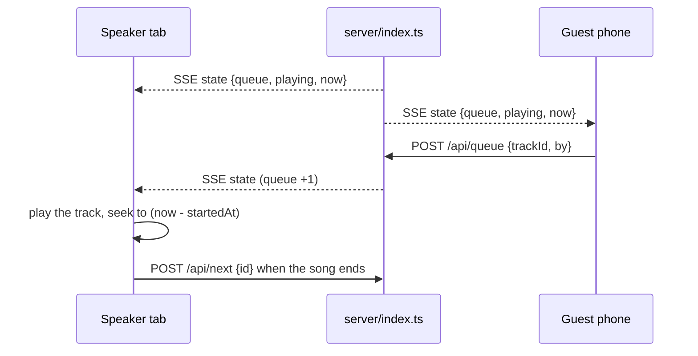

# tivi

A jukebox for one room: anybody queues from their phone, the browser wired to the speakers plays.
The library starts empty and the room fills it.

## Run it

```bash
bun install          # or: npm install
bun run dev          # API on :8787, UI on http://localhost:5173
bun run build        # tsc + vite -> dist/
bun start            # http://localhost:8787, one process for UI + API + audio
```

`PORT` moves the server. `JOIN_URL` is what the QR hands out, and defaults to the machine's LAN IPv4.

## Deploying

UI on Vercel, API on a box, one origin for the browser: `vercel.json` rewrites `/api/*`, `/media/*`
and `/qr.svg` to the box, so the client keeps relative paths and there is no CORS layer. On the box,
`tivi.service` runs the server on :8787 and `tivi-tunnel.service` carries that port out through a
bore tunnel, which is why the port appears in two files. One Node host needs none of it:
`bun run build && bun start`.

## How it plays



- State lives in memory in `server/index.ts` and reaches every screen as a snapshot over SSE
  (`GET /api/events`), with `GET /api/state` for a one-shot read.
- `playing.startedAt` is the only clock: position is `(pausedAt ?? now) - startedAt`, pause shifts
  the start, and `now` in every snapshot cancels each client's drift, so a tab that opens mid-song
  seeks to the right second.
- `POST /api/queue`, `/api/next`, `/api/pause` and `DELETE /api/queue/:id` mutate it. `next` carries
  the id the caller thinks is playing, so six open tabs do not skip six songs.
- Volume and mute are per device; the queue and pause are shared.

## Adding music

Four ways in, one pipeline: everything ends as a local file in `data/media/` and joins the library
over the same SSE stream.

- A song name searches archive.org scoped to `collection:78rpm`, so every row it offers can actually
  be played here. Picking one downloads the recording.
- An archive.org link skips the search. The resolver takes the largest mp3 in the item, caches it,
  and caches the label scan as the sleeve.
- A YouTube or Spotify link is read through its oEmbed endpoint for its title and then searched by
  that title, because the link itself cannot be streamed here.
- A file upload takes mp3, ogg, wav, flac, m4a or aac up to 25 MB, and the library holds 60 tracks.
  An upload carries no picture of its own, so the sleeve is looked up in the iTunes catalogue by
  title, with a second pass against the JP store for titles that are not romanised.

archive.org answers in ten seconds one moment and not at all the next, so downloads are retried
once and the panel says so while it works. `data/` is gitignored: on an ephemeral disk the library
is gone after a restart.

## The screen

Left is the sleeve at real 12-inch size, with the name and the volume ladder under it. The name is
struck twice, white and then the record's accent stepped down and right like misregistered ink.
Right is everything you touch: the add-music box, the line, the library.

- `useArtworkTheme` runs node-vibrant over the cover and sets `--accent` and `--tint` on the
  document, so the wordmark, the progress bar and the QR card take the record's colour. It picks a
  vibrant swatch, since averaging paper and black shellac gives grey, and lifts a dark one toward
  white so the QR modules keep their contrast. Tapping the sleeve renders the cover as colour ASCII,
  one character per pixel block.
- The spectrum is a cava-style dot graph over 40Hz to 16kHz on a log scale, drawn from this device's
  own output through a Web Audio analyser. Each band is the mean of its FFT bins, every band shares
  one slowly falling ceiling, and each column snaps up and eases down.
- The Join button in the Library header opens the QR over everything. The server draws it as SVG
  from `JOIN_URL` with a minute of cache, so a restart cannot pin a stale address in a browser.
- Under 680px the layout stacks: sleeve, line, library. Under 600px of height the spectrum hides.

## Layout

```
shared/     types shared by both sides
server/     Hono app: library + queue state, SSE stream, archive.org resolver, static hosting
src/        React UI: App.tsx, Artwork.tsx (sleeve + colour ASCII), Logo.tsx, useArtworkTheme.ts, useJukebox.ts
public/     favicon (built into dist/)
data/       runtime library: library.json + every uploaded or fetched track and cover (gitignored)
```

## Not built

A proper request line (a YouTube link ends in an error instead of becoming a request), vote-to-skip,
and a search over the library itself. The library is one array in `server/library.ts`, so any of
them is additive.
