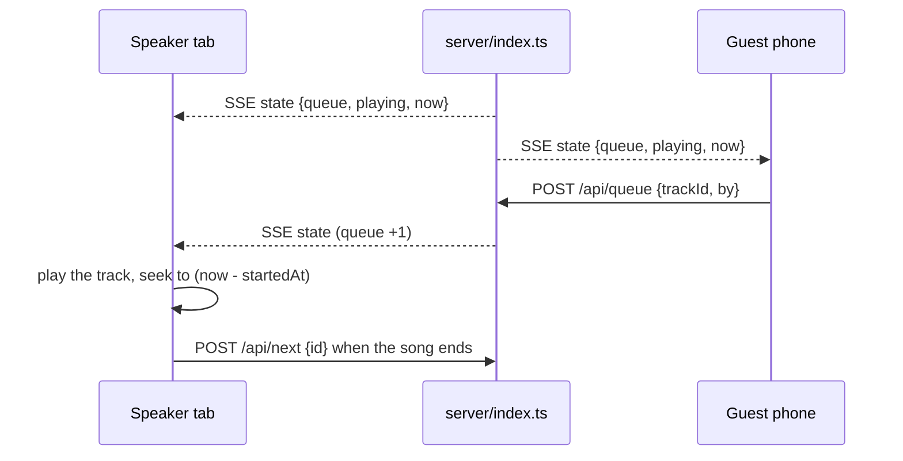

# tivi

## Description

A jukebox for one room. Anybody can queue a song from their phone, and the browser plugged into the
speakers plays it. The library starts empty and the room fills it.

## Screenshots


## Getting Started

### Dependencies

- Bun 1.4+ (or Node 22.12+ with npm; Vite's floor, and the scripts call `tsx` and `vite` from
  `node_modules`).
- No database and no external service. At runtime the network is only used for archive.org search
  and the iTunes catalogue; uploaded audio stays in `data/`.

### Installing

```bash
git clone https://github.com/karan-rusty/tivi.git
cd tivi
bun install          # or: npm install
```

### Executing program

```bash
bun run dev          # API on :8787, UI on http://localhost:5173
bun run build        # tsc + vite -> dist/
bun start            # http://localhost:8787, one process for UI + API + audio
```

`PORT` moves the server off 8787. `JOIN_URL` is the address the QR hands out, and defaults to the
machine's LAN IPv4.

## Deploying

The UI runs on Vercel and the API on a box, with the browser seeing one origin. `vercel.json`
rewrites `/api/*`, `/media/*` and `/qr.svg` to the box, so the client keeps relative paths and there
is no CORS layer. On the box, `tivi.service` runs the server on :8787 and `tivi-tunnel.service`
carries that port out through a bore tunnel. The port number sits in both files, so change them
together. A single host that runs Node needs none of this: `bun run build && bun start`.

## How it plays



- `server/index.ts` holds the state in memory and sends a snapshot to every screen over SSE at
  `GET /api/events`. `GET /api/state` is the one-shot read.
- `playing.startedAt` is the only clock. Position is `(pausedAt ?? now) - startedAt`, so pause just
  shifts the start, and `now` in every snapshot cancels each client's drift. A tab that opens
  mid-song seeks to the right second.
- The mutations are `POST /api/queue`, `/api/next`, `/api/pause` and `DELETE /api/queue/:id`. `next`
  carries the id the caller thinks is playing, so six open tabs do not skip six songs.
- Volume and mute are per device. The queue and pause are shared.

## Adding music

Everything ends as a local file in `data/media/`.

- A song name searches archive.org scoped to `collection:78rpm`.
- An archive.org link resolves straight away: largest mp3, label scan as the sleeve.
- A YouTube or Spotify link is read for its title through oEmbed, then searched by that title.
- An upload takes mp3, ogg, wav, flac, m4a or aac up to 25 MB, and the library holds 60 tracks. The
  sleeve comes from the iTunes catalogue, with a second pass against the JP store for titles that
  are not romanised.

## The screen

- `useArtworkTheme` asks node-vibrant for the cover's vibrant swatch and sets `--accent` and
  `--tint`, so the wordmark, progress bar and QR card take the record's colour. Tapping the sleeve
  shows it as colour ASCII.
- The spectrum is a cava-style dot graph from 40Hz to 16kHz, drawn from this device's own output.
  Each band is the mean of its FFT bins, all bands share one slowly falling ceiling, and a column
  snaps up and eases down.
- The QR is SVG drawn server-side from `JOIN_URL`, cached for a minute.

## Layout

```
shared/     types shared by both sides
server/     Hono app: library + queue state, SSE stream, archive.org resolver, static hosting
src/        React UI
data/       library.json + every uploaded or fetched track and cover (gitignored)
```

## Help

- A browser will not start audio before a gesture on that device. Click or tap the speaker tab once
  and playback follows; every later gesture retries if the first one was refused.
- Nothing plays until something is in the library. Search a name, paste an archive.org, YouTube or
  Spotify link, or upload a file.
- If the QR points at the wrong address, set `JOIN_URL` and restart the server.
- There is no request line: a YouTube link that matches nothing in the 78s says so. Vote-to-skip is
  missing too, and the library is one array in `server/library.ts`, so both are additive.

## License

This project is licensed under the MIT License - see the [LICENSE](LICENSE) file for details.
