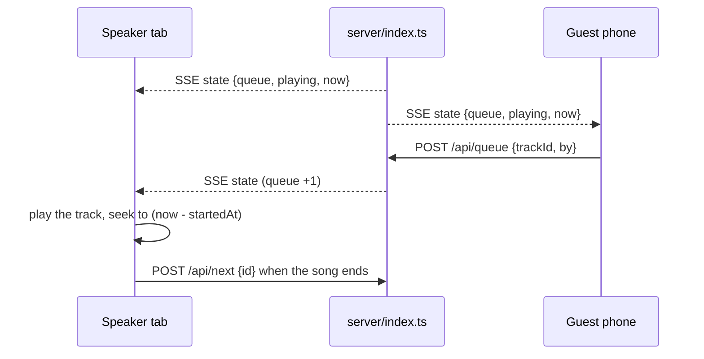

# tivi

A jukebox for one room: anybody queues from their phone, the browser wired to the speakers plays.
The library starts empty and the room fills it.

## Run it

```bash
bun install          # or: npm install
bun run dev          # API on :8787, UI on http://localhost:5173
bun run build        # tsc + vite -> dist/
bun start            # http://localhost:8787, one process for UI + API + audio
```

`PORT` moves the server. `JOIN_URL` is what the QR hands out, and defaults to the machine's LAN IPv4.

## Deploying

UI on Vercel, API on a box, one origin for the browser: `vercel.json` rewrites `/api/*`, `/media/*`
and `/qr.svg` to the box, so the client keeps relative paths and there is no CORS layer. On the box,
`tivi.service` runs the server on :8787 and `tivi-tunnel.service` carries that port out through a
bore tunnel, which is why the port appears in two files. One Node host needs none of it:
`bun run build && bun start`.

## How it plays



- State lives in memory in `server/index.ts` and reaches every screen as a snapshot over SSE
  (`GET /api/events`), with `GET /api/state` for a one-shot read.
- `playing.startedAt` is the only clock: position is `(pausedAt ?? now) - startedAt`, pause shifts
  the start, and `now` in every snapshot cancels each client's drift, so a tab that opens mid-song
  seeks to the right second.
- `POST /api/queue`, `/api/next`, `/api/pause` and `DELETE /api/queue/:id` mutate it. `next` carries
  the id the caller thinks is playing, so six open tabs do not skip six songs.
- Volume and mute are per device; the queue and pause are shared.

## Adding music

Everything ends as a local file in `data/media/`.

- A song name searches archive.org scoped to `collection:78rpm`.
- An archive.org link resolves straight away: largest mp3, label scan as the sleeve.
- A YouTube or Spotify link is read for its title through oEmbed, then searched by that title.
- An upload takes mp3, ogg, wav, flac, m4a or aac up to 25 MB, 60 tracks per library, and gets its
  sleeve from the iTunes catalogue, with a JP pass for titles that are not romanised.

## The screen

- `useArtworkTheme` takes a vibrant swatch from the cover and sets `--accent` and `--tint`, so the
  wordmark, progress bar and QR card wear the record's colour. Tapping the sleeve shows it as colour
  ASCII.
- The spectrum is a cava-style dot graph, 40Hz to 16kHz, drawn from this device's own output: the
  mean of each band's FFT bins, one shared falling ceiling, columns that snap up and ease down.
- The QR is SVG drawn server-side from `JOIN_URL`, with a minute of cache.

## Layout

```
shared/     types shared by both sides
server/     Hono app: library + queue state, SSE stream, archive.org resolver, static hosting
src/        React UI
data/       library.json + every uploaded or fetched track and cover (gitignored)
```

A YouTube link ends in an error instead of becoming a request, vote-to-skip is missing, and the
library is one array in `server/library.ts`, so either is additive.
