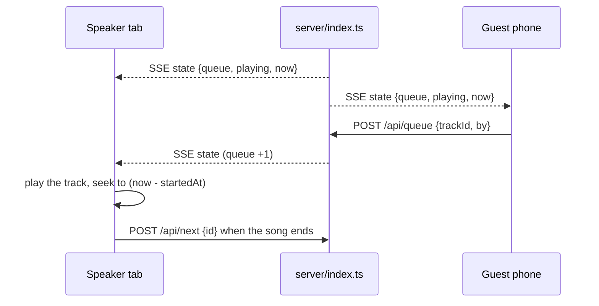

# tivi

A shared jukebox for the saloon. Anybody can queue a tune from their phone; one browser
plugged into the speakers plays it. No app to install — just a URL.

## What it does

- **Library of 6 tracks** — 1920s 78s, public domain, served straight from this repo.
- **Anyone can queue** — visitors hit *Add*; the queue is shared across every open tab and
  phone through a server-sent-events stream.
- **Play, pause, skip, volume** — pause/skip are shared (it is one jukebox, not six);
  volume and mute are local to the browser you are listening on.
- **Now playing** with a live progress bar, driven by the server's clock so every screen
  agrees on where the song is.
- **Survives a refresh** — a new tab picks the song up mid-play instead of restarting it.

## Run it

```bash
bun install          # or: npm install
bun run dev          # API on :8787, UI on http://localhost:5173
```

Production build (one process serves the UI, the API and the audio):

```bash
bun run build        # tsc + vite -> dist/
bun start            # http://localhost:8787   (PORT=8080 bun start to change it)
```

## Deploy the public URL

Any host that runs a Node process works — Render, Railway, Fly, a box in the corner:

1. push this repo to GitHub and create a **Web Service** from it
2. build: `npm ci && npm run build`
3. start: `npm start`
4. open the URL, put it on the machine wired to the speakers, hit *Add* once

The server binds to `$PORT`, so no host-specific config is needed. State lives in memory:
one process, no database, and a restart empties the saloon (fine for a night of requests).

Run it on more than one instance and the queue splits across them.

## How it works



- `server/index.ts` keeps `queue` + `playing` in memory and pushes a snapshot to every
  subscriber over SSE. Mutations: `POST /api/queue`, `POST /api/next`, `POST /api/pause`,
  `DELETE /api/queue/:id`, plus `GET /api/state` for a one-shot read.
- `playing.startedAt` is the only clock. Position = `(pausedAt ?? now) - startedAt`, which
  makes pause a single timestamp shift and lets any tab that joins late seek to the right
  spot. `now` rides along in every snapshot so clients can cancel out clock drift.
- Every tab plays the same song. That is the point of a jukebox, and it is why the volume
  control is local: turn it up on the machine wired to the speakers.
- Browsers do not allow audio before a user gesture, so a tab that has never been clicked
  shows a *Tap to turn on the speakers* button. Clicking anything (including *Add*) counts.
- `POST /api/next` carries the id of the song the caller thinks is playing. Whichever tab
  reaches the end first wins; the others are ignored, so six tabs do not skip six songs.

## The tracks

Public domain, from the Library of Congress *National Jukebox* collection on
[archive.org](https://archive.org/details/78rpm), encoded to mono 96 kbps mp3.

| Track | Artist | Year |
| --- | --- | --- |
| That Da-Da Strain | The Virginians (Ross Gorman) | 1922 |
| Whoa, Tillie, Take Your Time | The Virginians (Ross Gorman) | 1923 |
| Jim Jams | Roy Bargy | 1924 |
| I'm Haunted by That Swanee River Song | Fred Waring's Pennsylvanians | 1924 |
| Superstitious Blues | The Virginians (Ross Gorman) | 1924 |
| Burning Sands | Yerkes Jazarimba Orchestra | 1922 |

Swap in your own files by dropping them in `public/tracks/` and editing `shared/tracks.ts`.

## Not built

Search, a separate request line, vote-to-skip and QR-code joining were all considered and
left out to keep this small. `shared/tracks.ts` is the only place a track is described, so
adding any of them is additive.

## Layout

```
shared/     types + the track list (used by both sides)
server/     Hono app: queue state, SSE stream, static hosting of dist/
src/        React UI (App.tsx) and the SSE hook (useJukebox.ts)
public/     the audio files
```
