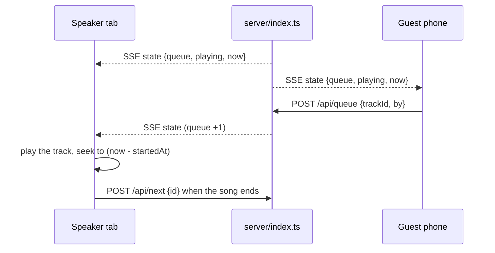

# tivi

A jukebox for one room. Anybody queues a tune from their phone; the browser plugged into the
speakers plays it. No app, no accounts, one URL.

The library starts empty and the saloon fills it: upload a file off a phone, paste an archive.org
link, or type a song name and pick from the public-domain 78s. Every screen sees the same queue and
the same second of the same song.

## Run it

```bash
bun install          # or: npm install
bun run dev          # API on :8787, UI on http://localhost:5173
bun run build        # tsc + vite -> dist/
bun start            # http://localhost:8787, one process for UI + API + audio
```

- `PORT` moves the server off 8787.
- `JOIN_URL` is the address the QR and the join card hand out. Left alone it uses the machine's LAN
  IPv4, which is the address a phone can actually reach.

## Deploying

The live setup is split: UI on Vercel, API on a box, one origin from the browser's point of view.

- `vercel.json` rewrites `/api/*`, `/media/*` and `/qr.svg` to the box, so the client keeps relative
  paths and there is no CORS layer or API base URL to configure. Change the tunnel port in that file
  and in the tunnel unit together, then rebuild the frontend.
- On the box, `tivi.service` runs the server on :8787 with `JOIN_URL` pointing at the public URL,
  and `tivi-tunnel.service` carries that port out through a bore tunnel.
- One process is one room. The queue lives in memory, so a restart empties the line. The library
  does not: it is a JSON file next to the audio.

A single host that runs Node needs none of this. `bun run build && bun start` serves the UI, the API
and the audio from one port.

## How it works



- `server/index.ts` keeps `queue` + `playing` in memory and pushes a snapshot to every
  subscriber over SSE. Mutations: `POST /api/queue`, `POST /api/next`, `POST /api/pause`,
  `DELETE /api/queue/:id`, plus `GET /api/state` for a one-shot read.
- `playing.startedAt` is the only clock. Position = `(pausedAt ?? now) - startedAt`, which
  makes pause a single timestamp shift and lets any tab that joins late seek to the right
  spot. `now` rides along in every snapshot so clients can cancel out clock drift.
- Every tab plays the same song. That is the point of a jukebox, and it is why the volume
  control is local: turn it up on the machine wired to the speakers.
- Browsers do not allow audio before a user gesture, so the first click or key press anywhere in a
  tab starts sound on that device. There is no prompt for it; the page just takes the gesture.
- `POST /api/next` carries the id of the song the caller thinks is playing. Whichever tab
  reaches the end first wins; the others are ignored, so six tabs do not skip six songs.

## The screen

```
┌───────┬──────────────────────────┬──────────────────┐
│ tivi  │  the record, sleeve size │  Up next  (line) │
│       │  (or its colour-ASCII)   │  Library         │
│ ▮▮▮▮  │                          │  ┌─────────────┐ │
│ ▮▮▮▮  │  title · artist · year   │  │ add a song  │ │
│  ▌    │  ────── progress ──────  │  └─────────────┘ │
│ 075%  │  ⏸ ⏭                    │  [Add] per song  │
│  🔈   │                          │                  │
└───────┴──────────────────────────┴──────────────────┘
```

- **Left: the sleeve**, with the name and the volume panel under it. The name runs up the gutter in
  the control-panel face, struck twice — a white pass and a second in the record's accent, stepped
  down and right like misregistered ink. No glow: the accent is pigment here, not a light source.
  A hairline and a 9px `78 rpm` spec sit beside it. The volume is a segmented ladder beside a pill
  track, drag it anywhere along its length or use the arrow keys. Both live in the record's own
  band rather than in the full-height left column, and the record is centred in that band, so the
  sign and the fader line up with the sleeve instead of with the middle of the page — at 1440×900,
  1440×1200, 1280×800 and 1152×780 their centre sits on the sleeve's centre to the pixel. The
  *Join* button sits in the Library header: it opens the QR over everything, with the address
  printed under it, and closes on Escape, on the X, or on a click outside. It is the only thing on
  screen asking to be scanned, so it stays out of the way until somebody wants it.
- **Right: everything you touch.** Add-music controls, the line, and the library.
- **The theme comes from the record.** `useArtworkTheme` runs node-vibrant over the cover and sets
  `--accent` / `--tint` on the document, so the wordmark's second pass, the progress bar, buttons
  and page glow all take the record's own colour. It takes a *vibrant* swatch rather than an
  average: a label scan is mostly paper and black shellac, and averaging those gives grey. The QR
  card rides the same variable, so it changes with the song — the six records land at 12.7–15.8:1
  against the black modules, and even a pure-black accent (which the theme lifts toward white)
  leaves 5.3:1, well past what a scanner needs. The modules themselves stay black: that is the part
  the camera reads.
- On a phone it stacks: sleeve, then line, then library.

## The tracks

Public domain, from the Library of Congress *National Jukebox* collection on
[archive.org](https://archive.org/details/78rpm), encoded to mono 96 kbps mp3.

| Track | Artist | Year |
| --- | --- | --- |
| That Da-Da Strain | The Virginians (Ross Gorman) | 1922 |
| Whoa, Tillie, Take Your Time | The Virginians (Ross Gorman) | 1923 |
| Jim Jams | Roy Bargy | 1924 |
| I'm Haunted by That Swanee River Song | Fred Waring's Pennsylvanians | 1924 |
| Superstitious Blues | The Virginians (Ross Gorman) | 1924 |
| Burning Sands | Yerkes Jazarimba Orchestra | 1922 |

Swap in your own files by dropping them in `public/tracks/` and editing the seed in
`server/library.ts`, or add them at runtime (below). Label scans live in `public/tracks/art/`;
archive.org items get theirs cached automatically. An **uploaded** file has no artwork, so it plays
with a stand-in sleeve and the default amber theme — the only place the "theme follows the record"
promise cannot hold.

## Adding music

**One box takes whatever somebody has.** Type a song, a name, or a link; press Enter. Everything
ends as a local cached file, so every listener still hears the same second as the built-in tracks.

1. **A song name** — searches the public-domain 78s and shows up to eight tappable rows
   (`Oil Well ◆ Jelly-Roll Morton ◆ 1950`). Tapping one caches that recording and puts it on the
   line. The search is scoped to `collection:78rpm`, so *everything it offers can actually be
   played here* — that is the whole point of taking a request by name.
2. **An archive.org link** — exact, so it is added straight away rather than searched for.
3. **A YouTube or Spotify link** — read for its title and then searched for *by that title*, since
   the link itself cannot be streamed here. Paste a Rick Astley video and the panel says what it
   read and that no 78 of it exists. Paste a 1930s jazz video and it usually finds the record.
4. **A file** — pick an mp3/ogg/wav/flac/m4a off the device. Up to 25 MB, 60 tracks per library.

When only a link is available, that is the honest limit: Spotify playback needs Premium on **every**
listener (and its 30-second previews are gone for new apps), and YouTube's terms require its own
visible player of at least 200×200px and forbid separating the audio. So a link-playback path means
either a subscription per guest or a video watch party that breaks the shared clock. Reading a
link's *title* and finding a public-domain pressing of the same song costs nothing and plays.

What you add is queued immediately and shows up in everyone's library over the same SSE stream.
Resolving an archive.org item takes 10–30 seconds — it is downloading a real recording — and the
panel says so while it works. archive.org drops a request every so often, so downloads are retried
once and failures say "give it another go" rather than pretending nothing happened.

Uploads and downloads live in `data/`, which is gitignored: on a host with an ephemeral disk they
are gone after a restart, so attach a volume if the library should survive the night.


## Not built

Search, a proper request line (a YouTube link shows as a request instead of an error), and
vote-to-skip were all considered and left out to keep this small. The library is one array
in `server/library.ts`, so any of them is additive.

## Layout

```
shared/     types shared by both sides
server/     Hono app: library + queue state, SSE stream, archive.org resolver, static hosting
src/        React UI: App.tsx, Artwork.tsx (sleeve + colour ASCII), Logo.tsx (the wordmark), useArtworkTheme.ts, useJukebox.ts
public/     the six built-in audio files and their label scans (built into dist/)
data/       runtime library: library.json + every uploaded or fetched track and cover (gitignored)
```
