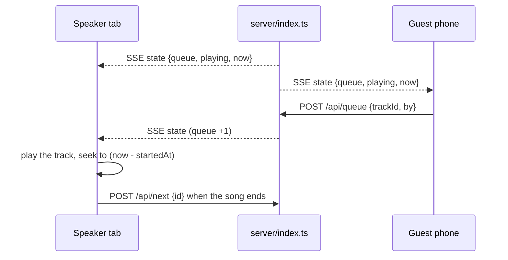

# tivi

A shared jukebox for the saloon. Anybody can queue a tune from their phone; one browser
plugged into the speakers plays it. No app to install — just a URL.

## What it does

- **Library of 6 tracks** — 1920s 78s, public domain, served straight from this repo with their
  record label scans.
- **Anyone can add music** — upload a file off a phone, or paste an archive.org link; the server
  caches the audio, and the track joins everyone's library instantly.
- **Anyone can queue** — visitors hit *Add*; the queue is shared across every open tab and
  phone through a server-sent-events stream.
- **A screen that listens to the record** — the sleeve is shown at full size, the whole UI takes
  its accent colour from the cover, and one tap renders it as colour ASCII.
- **Play, pause, skip, volume** — pause/skip are shared (it is one jukebox, not six);
  volume and mute are local to the browser you are listening on.
- **Now playing** with a live progress bar, driven by the server's clock so every screen
  agrees on where the song is.
- **Survives a refresh** — a new tab picks the song up mid-play instead of restarting it.

## Run it

```bash
bun install          # or: npm install
bun run dev          # API on :8787, UI on http://localhost:5173
```

Production build (one process serves the UI, the API and the audio):

```bash
bun run build        # tsc + vite -> dist/
bun start            # http://localhost:8787   (PORT=8080 bun start to change it)
```

## Deploy the public URL

Any host that runs a Node process works — Render, Railway, Fly, a box in the corner:

1. push this repo to GitHub and create a **Web Service** from it
2. build: `npm ci && npm run build`
3. start: `npm start`
4. open the URL, put it on the machine wired to the speakers, hit *Add* once

The server binds to `$PORT`, so no host-specific config is needed. State lives in memory:
one process, no database, and a restart empties the saloon (fine for a night of requests).

Run it on more than one instance and the queue splits across them.

## How it works



- `server/index.ts` keeps `queue` + `playing` in memory and pushes a snapshot to every
  subscriber over SSE. Mutations: `POST /api/queue`, `POST /api/next`, `POST /api/pause`,
  `DELETE /api/queue/:id`, plus `GET /api/state` for a one-shot read.
- `playing.startedAt` is the only clock. Position = `(pausedAt ?? now) - startedAt`, which
  makes pause a single timestamp shift and lets any tab that joins late seek to the right
  spot. `now` rides along in every snapshot so clients can cancel out clock drift.
- Every tab plays the same song. That is the point of a jukebox, and it is why the volume
  control is local: turn it up on the machine wired to the speakers.
- Browsers do not allow audio before a user gesture, so a tab that has never been clicked
  shows a *Tap to turn on the speakers* button. Clicking anything (including *Add*) counts.
- `POST /api/next` carries the id of the song the caller thinks is playing. Whichever tab
  reaches the end first wins; the others are ignored, so six tabs do not skip six songs.

## The screen

```
┌──────────────────────────────┬──────────────────┐
│  the record, sleeve size     │  Up next  (line) │
│  (or its colour-ASCII view)  │  Library         │
│                              │  ┌─────────────┐ │
│  title · artist · year       │  │ add a song  │ │
│  ────── progress ──────      │  └─────────────┘ │
│  ⏸ ⏭            🔈 ────○──   │  [Add] per song  │
└──────────────────────────────┴──────────────────┘
```

- **Left: the sleeve.** The record label scan at full size, with a button that redraws it as
  colour ASCII — each character takes the colour of the pixel it stands for, so the label stays
  readable. Transport controls sit under it.
- **Right: everything you touch.** Add-music controls, the line, and the library.
- **The theme comes from the record.** `useArtworkTheme` runs node-vibrant over the cover and sets
  `--accent` / `--tint` on the document, so the progress bar, buttons and page glow all take the
  record's own colour. It takes a *vibrant* swatch rather than an average: a label scan is mostly
  paper and black shellac, and averaging those gives grey.
- On a phone it stacks: sleeve, then line, then library.

## The tracks

Public domain, from the Library of Congress *National Jukebox* collection on
[archive.org](https://archive.org/details/78rpm), encoded to mono 96 kbps mp3.

| Track | Artist | Year |
| --- | --- | --- |
| That Da-Da Strain | The Virginians (Ross Gorman) | 1922 |
| Whoa, Tillie, Take Your Time | The Virginians (Ross Gorman) | 1923 |
| Jim Jams | Roy Bargy | 1924 |
| I'm Haunted by That Swanee River Song | Fred Waring's Pennsylvanians | 1924 |
| Superstitious Blues | The Virginians (Ross Gorman) | 1924 |
| Burning Sands | Yerkes Jazarimba Orchestra | 1922 |

Swap in your own files by dropping them in `public/tracks/` and editing the seed in
`server/library.ts`, or add them at runtime (below). Label scans live in `public/tracks/art/`;
archive.org items get theirs cached automatically. An **uploaded** file has no artwork, so it plays
with a stand-in sleeve and the default amber theme — the only place the "theme follows the record"
promise cannot hold.

## Adding music

Two ways in, both from the browser, both ending as a local cached file so every listener still
hears the same second as the built-in tracks:

1. **Upload a file** — pick an mp3/ogg/wav/flac/m4a off your phone. Up to 25 MB per file, 60
   tracks per library.
2. **Paste an archive.org link** — `https://archive.org/details/<item>`. The server reads the
   item's metadata, takes its **largest** mp3 (several items ship a truncated derivative that
   would stall the queue), downloads it into `data/tracks/`, and titles the track from the item.

What you add is queued immediately and shows up in everyone's library over the same SSE stream.
Uploads and downloads live in `data/`, which is gitignored: on a host with an ephemeral disk they
are gone after a restart, so attach a volume if the library should survive the night.

YouTube and Spotify links are rejected with a reason, deliberately. Spotify playback needs Premium
on **every** listener (and its 30-second previews are no longer available to new apps), and
YouTube's terms require its own visible player of at least 200×200px and forbid separating the
audio — so a link-playback path means either a subscription per guest or a video watch party that
breaks the shared clock. Public-domain archive.org links give the same "paste a link" feel with
none of that.

## Not built

Search, a proper request line (a YouTube link shows as a request instead of an error), vote-to-skip
and QR-code joining were all considered and left out to keep this small. The library is one array
in `server/library.ts`, so any of them is additive.

## Layout

```
shared/     types shared by both sides
server/     Hono app: library + queue state, SSE stream, archive.org resolver, static hosting
src/        React UI: App.tsx, Artwork.tsx (sleeve + colour ASCII), useArtworkTheme.ts, useJukebox.ts
public/     the six built-in audio files and their label scans (built into dist/)
data/       runtime library: library.json + every uploaded or fetched track and cover (gitignored)
```
